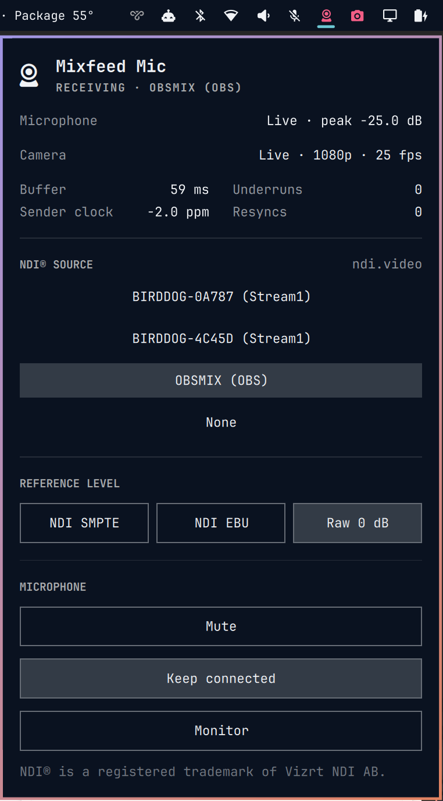
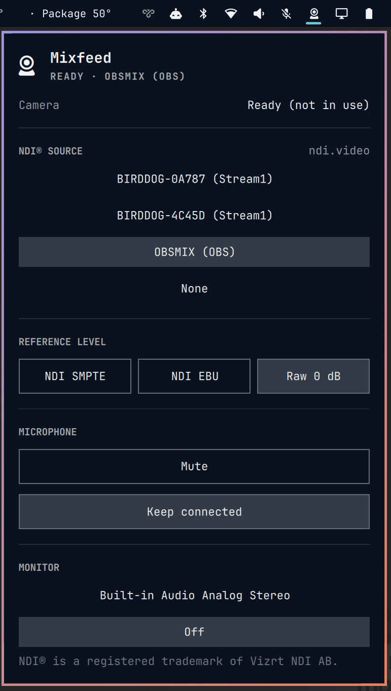

# Mixfeed widget for Omarchy

Bar widget for [Mixfeed](https://github.com/vpacher/mixfeed). Mixfeed receives an [NDI®](https://ndi.video/) source on Linux and gives it to your applications as a microphone ("Mixfeed Mic") and a webcam ("Mixfeed").

The widget shows the state of the microphone and the camera, and lights up while an application uses them (on air). Its panel selects the NDI source and the reference level, and controls Mute, Keep connected and the headphone Monitor.

NDI® is a registered trademark of Vizrt NDI AB. Mixfeed is not a product of NDI and is not affiliated with NDI.

| On air | Ready |
|---|---|
|  |  |

## Requirements

The widget is the control for the Mixfeed service `mixfeedd`. It does not receive NDI itself. Without `mixfeedd` it shows "mixfeedd not running" and a link to the install.

| Part | Where |
|---|---|
| Omarchy 4 (shell plugins) | [omarchy.org](https://omarchy.org/) |
| Mixfeed (`mixfeedd`, `mfctl`) | [github.com/vpacher/mixfeed](https://github.com/vpacher/mixfeed) |
| NDI runtime 6 | AUR `ndi-sdk` ([ndi.video](https://ndi.video/)) |

## Install

Install Mixfeed. Its install script also installs and enables this widget:

```sh
git clone https://github.com/vpacher/mixfeed.git
cd mixfeed
linux/install.sh
```

The Mixfeed README has the full procedure (requirements, camera, firewall).

If Mixfeed is installed already, you can add the widget alone:

```sh
omarchy plugin add https://github.com/vpacher/omarchy-mixfeed.git --enable
```

## Update

```sh
omarchy plugin update vpacher.mixfeed
```

`linux/install.sh` of Mixfeed also updates the widget.

## Remove

Remove the widget only:

```sh
omarchy plugin remove vpacher.mixfeed
```

Remove Mixfeed with the widget:

```sh
cd mixfeed
linux/install.sh remove
```

## Use

Click the Mixfeed icon in the bar to open the panel.

Keys in the panel: `j`/`k` or the arrow keys move, `Enter` or `Space` selects, `r` refreshes, `Esc` closes.

The widget calls `~/.local/bin/mfctl` (installed with Mixfeed) to read the state and to change settings. It opens a browser for the links to ndi.video and to the Mixfeed repository.

## Security

Report vulnerabilities privately; see [SECURITY.md of Mixfeed](https://github.com/vpacher/mixfeed/blob/main/SECURITY.md).

## Licence

MIT or Apache-2.0, at your choice. See `LICENSE`, `LICENSE-MIT` and `LICENSE-APACHE`.
